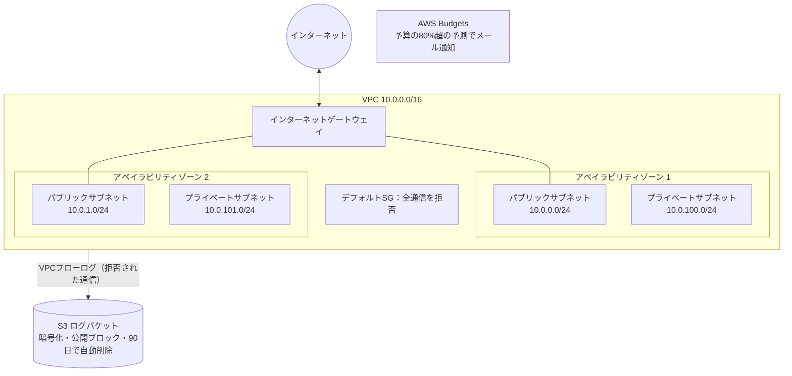

# terraform-aws-baseline

AWS に小さく安全な土台環境を作る Terraform コードです。
「最初に作るべき基本構成」を、費用を抑えつつセキュリティの基本を押さえた形でまとめています。

## 構成図



## 作られるもの

| リソース | 内容 |
| --- | --- |
| VPC | 2 つのアベイラビリティゾーンに、パブリック／プライベートの 2 層サブネット |
| ルーティング | パブリックはインターネットゲートウェイ経由、プライベートは外部経路なし |
| デフォルト SG | すべての通信を拒否（CIS ベンチマーク準拠） |
| S3（ログ） | 暗号化・公開ブロック・バージョニング・90 日で自動削除 |
| VPC フローログ | 拒否された通信を S3 に記録 |
| AWS Budgets | 月額予算の 80% を超える予測で通知 |

ネットワークは `modules/network` にモジュールとして分けています。

## 費用について

NAT ゲートウェイは時間課金のため作っていません。
上記の構成は、ほぼ無料枠の範囲で動きます（ログの保存量に応じた S3 料金のみ）。
試した後は `terraform destroy` で削除してください。

## 使い方

```bash
cp terraform.tfvars.example terraform.tfvars   # 通知先メールなどを編集
terraform init
terraform plan
terraform apply
terraform destroy   # 片付け
```

AWS の認証は、`aws configure` や IAM Identity Center（`aws sso login`）で設定してください。
アクセスキーをコードやリポジトリに書かないでください。

## CI

GitHub Actions で、push と Pull Request のたびに次を自動実行します（AWS の認証情報は不要）。

- `terraform fmt -check`（書式）
- `terraform validate`（構文）
- `tflint`（静的解析）

## 今後の拡張

- state を S3 に移す（`versions.tf` にコメントで用意済み）
- GitHub Actions から OIDC で AWS に接続し、Pull Request で `terraform plan` を表示
- プライベートサブネット向けの VPC エンドポイント
